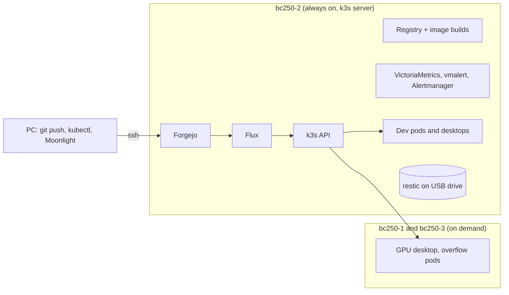

# bc250-gitops

A three-node Kubernetes cluster built from AMD BC-250 boards (cast-off crypto-mining blades with a
PS5-class APU), run entirely from this Git repository. Flux applies whatever is on `main`.


## What it does

- **GitOps:** k3s plus Flux. A commit is the only way anything changes. Secrets are encrypted with
  SOPS and age. In this public copy, each `*.sops.yaml` is a template with placeholder values.
- **Self-hosted platform:** Forgejo for Git, a registry with podman image builds, Traefik,
  VictoriaMetrics with vmalert and Alertmanager (alerts go to Discord), and restic backups to a
  USB drive with a daily copy to Backblaze B2.
- **AI dev pods:** one Claude Code pod per project, started and stopped with `hl`, plus GPU desktops
  streamed over Moonlight. Agents can message each other. An agent can also ask for more packages,
  CPU or memory for its own pod; the request is applied automatically if it stays within set limits.
- **Guardrails:** every namespace gets a quota, limits and default-deny network policies. Dev pods
  reach only the internet and the Git server. An admission policy limits what Jobs they can
  create, and priority classes plus tuned kubelet eviction decide what goes first under memory
  pressure.
- **Shared GPUs:** a device plugin exposes each APU as a whole-GPU resource that Jobs queue for,
  and as shared render nodes for desktops.
- **Services:** the [homelab-console](https://github.com/nitpreet22/homelab-console) dashboard and
  an S3-compatible store (Garage) for DVC data.

## Architecture



The boards are on a 2.5 GbE switch. The case and cooling are in
[bc250-chassis](https://github.com/nitpreet22/bc250-chassis).

## Layout

| Folder | What's in it |
|---|---|
| `bootstrap/` | One-time board setup (network, k3s, Forgejo, herdr), image builds and checks |
| `clusters/home/` | Flux entry point: the `infrastructure` and `apps` Kustomizations |
| `infrastructure/` | Namespaces and guardrails, priorities, policies, device plugins, monitoring, backups, registry, Traefik |
| `templates/` | `agent` (Claude Code dev pod) and `desktop` (Moonlight desktop), with reusable components |
| `apps/<namespace>/<project>/` | One folder per project: a template overlay and/or its running service. The projects themselves stay private; `apps/ml/example-project` shows how one is declared |
| `images/` | Containerfiles for every image the cluster builds itself |
| `scripts/` | `hl` (dev pods), restore and volume tools, secret generators |
| `tests/` | Eviction-order and GPU load tests, unit tests for the scripts |

## Using it

```bash
hl ls                      # every project: namespace, state, CPU, memory
hl up <project>            # start its dev pod and wait until ready
hl attach <project>        # Claude Code inside the pod
hl down <project>          # stop it; the volume keeps code and history

bootstrap/build-image.sh <image> <tag> [<repo>]   # build a commit on bc250-2, push to the registry
flux reconcile kustomization apps --with-source   # apply the latest commit now
bootstrap/check-platform.sh                       # GPU queue and network-policy checks
```

To deploy something, build an image from a commit, set its tag in the manifest here, then commit
and push. To roll back, put the old tag back.

## License

MIT. See [LICENSE](LICENSE).
